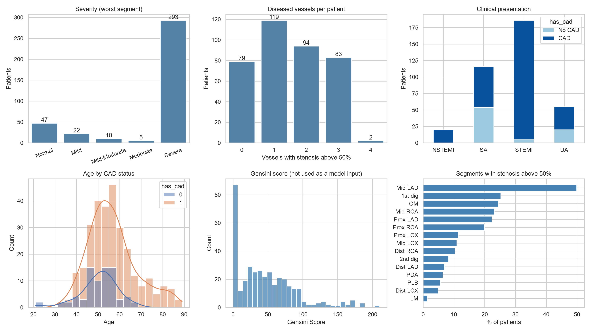
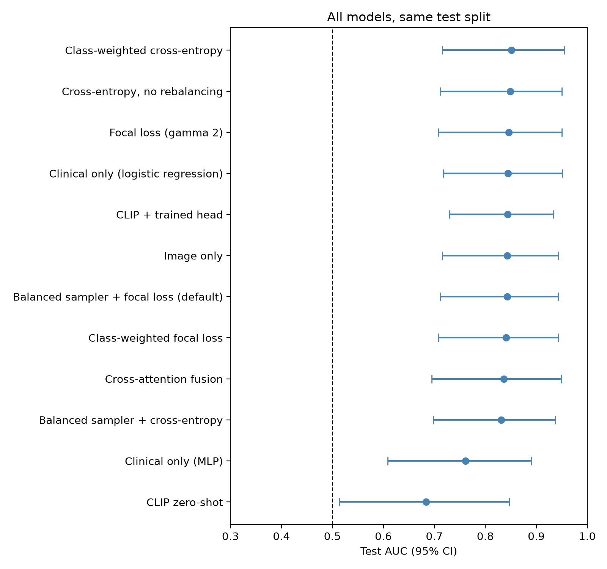
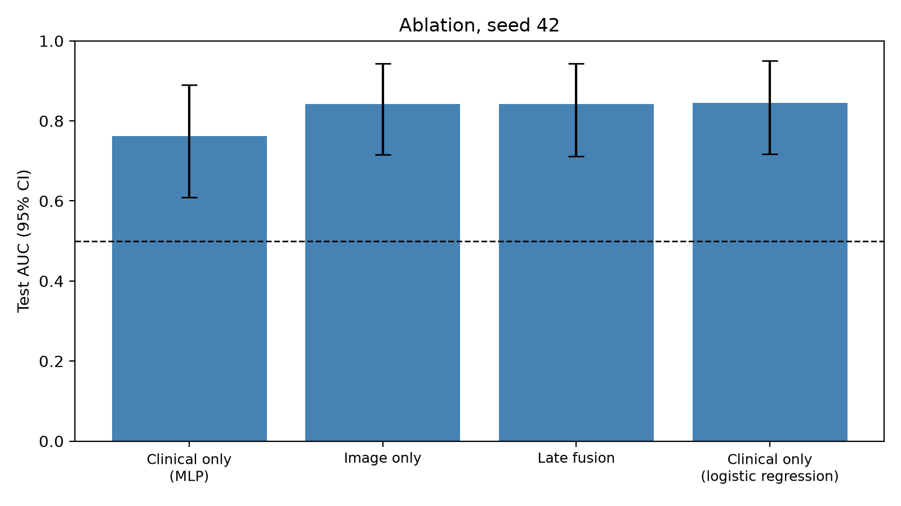
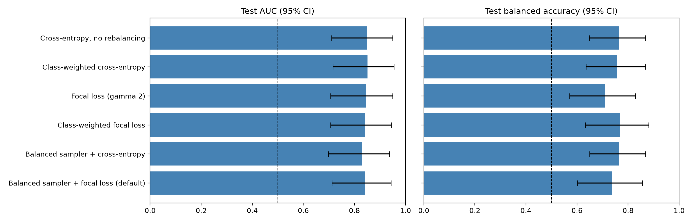

# AngioCAD: How Much Do Multimodal Fusion and Vision-Language Models Add to Coronary Artery Disease Detection?

A reproducible benchmark on a small, high-prevalence angiography cohort.

> **Status.** Research code. The numbers below come from one patient-level train / validation / test split of 377 patients. The test set contains 76 patients, only 16 of them without CAD, so every confidence interval is wide. Nothing here is validated for clinical use.

---

## Summary

We asked a simple question: on a cohort of this size, does combining invasive coronary angiography frames with routine clinical variables detect coronary artery disease (CAD) better than either source alone, and can a general-purpose vision-language model do the job without training?

We compared twelve supervised configurations and two zero-shot vision-language models (VLMs) on the same held-out patients, with patient-level bootstrap confidence intervals and paired significance tests. The answer on this cohort is no:

- **Five very different approaches reach the same test AUC of about 0.84.** An image-only ResNet-18 (0.843), late fusion (0.843), cross-attention fusion (0.836), CLIP with a trained head (0.844) and a plain logistic regression on the clinical variables (0.845) cannot be told apart.
- **Fusion looked best on validation and did not hold up.** Late fusion reached a validation AUC of 0.914 ± 0.017 over three seeds, against 0.841 ± 0.004 for the image-only model. On the test set the two are identical (ΔAUC = 0.000, 95% CI −0.070 to 0.068).
- **The only significant pairwise difference involves a weak baseline.** Fusion beats the clinical multilayer perceptron (ΔAUC = +0.081, p = 0.039, uncorrected), but that network is itself well below logistic regression on the same inputs (0.761 against 0.845).
- **How class imbalance is handled made no measurable difference.** Six strategies, from plain cross-entropy to a balanced sampler with focal loss, give test AUCs between 0.831 and 0.851; no paired comparison against plain cross-entropy approaches significance.
- **Zero-shot VLMs do not work here.** Qwen3-VL-8B answers "no" for 67 of 76 patients and InternVL3-8B answers "yes" for 68 of 76. Neither ranks patients better than chance (AUC 0.307 and 0.500).

We report this as a negative result. Its practical message is that a validation gain on a few dozen patients is not evidence, and that a linear clinical baseline belongs in every table of this kind.

---

## Contents

1. [Dataset](#1-dataset)
2. [Methods](#2-methods)
3. [Results](#3-results)
4. [Zero-shot vision-language models](#4-zero-shot-vision-language-models)
5. [Limitations](#5-limitations)
6. [Planned improvements](#6-planned-improvements)
7. [Repository layout](#7-repository-layout)
8. [Reproducing the results](#8-reproducing-the-results)
9. [Environment](#9-environment)
10. [Citation, data and license](#10-citation-data-and-license)

---

## 1. Dataset

### 1.1 Cohort

The AngioCAD data consist of two spreadsheets and a folder of angiographic series. Segment-level stenosis grades are available for 413 patients and clinical variables for 377. The study cohort is the 377 patients present in both. One of them (ID 157) has no image files and takes part only in the clinical-only experiments.

| | |
|---|---|
| Patients in the cohort | 377 |
| CAD present / absent | 298 (79.0%) / 79 (21.0%) |
| Patients with extracted frames | 376 |
| Extracted frames | 13,353 (left coronary 7,137; right coronary 6,216) |
| Frame size | 224 × 224, greyscale |
| Clinical inputs after encoding | 39 |

### 1.2 Label definition

Fifteen coronary segments (LM; proximal, mid and distal LAD; first and second diagonal; proximal, mid and distal LCX; OM; proximal, mid and distal RCA; PDA; PLB) are graded in bands: NL, 1–25, 26–50, 51–75, 76–90, 91–99 and 100%. Each band is represented by its midpoint.

**A patient is CAD-positive when at least one segment is graded 51–75% or worse.** A stenosis of exactly 50% falls in the 26–50 band and is therefore negative, so the label means "more than 50%" and not "at least 50%". It is an angiographic label; it says nothing about functional ischaemia or the indication for revascularisation.

| Worst segment | Patients | | Diseased epicardial vessels | Patients |
|---|---|---|---|---|
| Normal | 47 | | 0 | 79 |
| Mild (1–25%) | 22 | | 1 | 119 |
| Mild to moderate (26–50%) | 10 | | 2 | 94 |
| Moderate (51–75%) | 5 | | 3 | 83 |
| Severe (76% or more) | 293 | | 4 (including left main) | 2 |

The mid LAD is the segment most often diseased (49.9% of patients), followed by the first diagonal (25.2%) and the obtuse marginal (24.4%).

### 1.3 Baseline characteristics

Continuous variables are given as median [interquartile range] and compared with the Mann-Whitney U test; categorical variables as n (%) and compared with the chi-square test. Percentages use the patients with a recorded value as denominator. The p-values are descriptive and not corrected for multiple testing. The complete table is in `results/table1_baseline_characteristics.csv`.

| Variable | All (n = 377) | No CAD (n = 79) | CAD (n = 298) | p |
|---|---|---|---|---|
| Age, years | 54.0 [49.0, 60.0] | 52.0 [46.0, 56.0] | 55.0 [49.0, 62.0] | < 0.001 |
| Male sex | 266 (70.6%) | 32 (40.5%) | 234 (78.5%) | < 0.001 |
| BMI, kg/m² | 27.5 [24.5, 30.8] | 29.3 [26.0, 33.6] | 26.8 [24.2, 30.1] | < 0.001 |
| LVEF, fraction | 0.45 [0.30, 0.55] | 0.55 [0.49, 0.60] | 0.40 [0.30, 0.50] | < 0.001 |
| Fasting blood sugar, mg/dL | 110.0 [94.0, 146.8] | 95.0 [87.0, 104.5] | 118.0 [97.0, 159.5] | < 0.001 |
| HDL, mg/dL | 42.0 [36.0, 49.0] | 47.0 [42.5, 54.0] | 41.0 [36.0, 48.0] | < 0.001 |
| Leukocytes, per µL | 8800 [7000, 11500] | 6800 [5700, 8600] | 9550 [7500, 12475] | < 0.001 |
| Current smoker | 106 (32.0%) | 9 (12.0%) | 97 (37.9%) | < 0.001 |
| Diabetes | 94 (24.9%) | 17 (21.5%) | 77 (25.8%) | 0.520 |
| Hypertension | 123 (32.6%) | 25 (31.6%) | 98 (32.9%) | 0.941 |
| Hyperlipidaemia | 71 (18.8%) | 8 (10.1%) | 63 (21.1%) | 0.039 |

### 1.4 Clinical presentation and why it matters

| Presentation | Patients | With CAD |
|---|---|---|
| STEMI | 186 | 181 (97.3%) |
| Stable angina | 116 | 62 (53.4%) |
| Unstable angina | 55 | 35 (63.6%) |
| NSTEMI | 20 | 20 (100%) |

Half of the cohort presented with STEMI, and almost all of those patients have CAD. Several of the variables that differ most between the groups in the table above (LVEF, leukocytes, blood sugar) are also markers of an acute infarction. A model can therefore score well by recognising an acute presentation without recognising a stenosis. Presentation is not a model input, but it is a confounder that any reading of the results has to keep in mind; Section 3.6 looks at it directly.

### 1.5 Data quality

- **Missing values.** LVEF and its dysfunction grade are missing for 22% of patients, smoking status for 12%, BMI, height and weight for 8–9%, statin use for 6%; every other variable is below 3%.
- **Implausible entries.** A handful of values look like unit or typing errors, for example BMI 148.7, haemoglobin 129, creatinine 23 and platelet counts of 2.4–2.7. They are not corrected by hand; numeric inputs are clipped to the 1st–99th percentile of the training split.
- **Column names.** The source sheet contains a `BUN ` header with a trailing space, `Astatine` for statin use and `Length` for height. Headers are stripped on load; the names are otherwise kept as supplied.
- **Not used as inputs.** The Gensini score is computed from the angiogram and would leak the label. `Diagnosis` and `IHD` are kept for subgroup analysis only.



---

## 2. Methods

### 2.1 Splits and preprocessing

Patients are split once, at patient level and stratified on the label, with a fixed seed of 42. All frames of a patient belong to the same split.

| Split | Patients | CAD | No CAD |
|---|---|---|---|
| Training | 255 | 202 | 53 |
| Validation | 46 | 36 | 10 |
| Test | 76 | 60 | 16 |

The tabular pipeline is fitted on the training patients only: clipping to the 1st–99th percentile, median imputation and standardisation for the 22 numeric variables; most-frequent imputation and one-hot encoding (one column per binary variable) for the 17 categorical ones. This gives 39 inputs.

For images, up to ten frames are sampled evenly from every labelled right- and left-coronary series and resized to 224 × 224. Training augmentation is a mild random affine transform (rotation up to 10°, translation up to 5%, scale 0.95–1.05) with brightness and contrast jitter. Horizontal flips are not used, because left-right orientation carries anatomical meaning in angiographic views.

### 2.2 Models

| Model | Description |
|---|---|
| Clinical only, logistic regression | L2-regularised (C = 1), balanced class weights, 39 inputs |
| Clinical only, MLP | 39 → 128 (LayerNorm, dropout 0.5) → 128 → 64 → 2, Gaussian input noise (σ = 0.1) |
| Image only | ImageNet-pretrained ResNet-18, stem and first residual stage frozen, 512 → 256 projection, 64-unit head |
| Late fusion | Image embedding (256) and clinical embedding (128) concatenated, 64-unit head, modality dropout 0.2 |
| Cross-attention fusion | Four image tokens and one token per clinical variable attend to each other in two cross-attention layers (width 128, four heads) |
| CLIP zero-shot | CLIP ViT-B/32, each frame scored against three pairs of "normal" / "stenosis" descriptions |
| CLIP with a trained head | CLIP ViT-B/32 frozen except its two projection layers; a small classifier on the image embedding and the embedding of a sentence describing the patient |
| Qwen3-VL-8B, InternVL3-8B | Zero-shot, 4-bit quantised, one yes / no question per frame (Section 4) |

Image-based models treat frames as instances of the patient: every frame inherits the patient's label, and frame probabilities are averaged to one score per patient. The supervised image and fusion models see every extracted frame (about 35 per patient); the CLIP and VLM baselines see four frames per patient, taken from the middle of different series and from both coronary arteries.

### 2.3 Training

All supervised networks share one recipe, so that differences between them come from their inputs and not from tuning: AdamW (learning rate 2 × 10⁻⁴, ten times lower for the backbone, weight decay 10⁻²), cosine schedule, batch size 32, at most 25 epochs, gradient clipping at 5.0, mixed precision on the GPU, and early stopping when the patient-level validation AUC has not improved for six epochs. The default objective is focal loss (γ = 2) with label smoothing of 0.05 and a sampler that gives every patient and both classes equal weight. The CLIP head uses its own schedule (learning rate 5 × 10⁻⁵, at most 15 epochs).

The modality ablation (clinical MLP, image only, late fusion) is repeated with seeds 42, 43 and 44. The imbalance study, cross-attention fusion and the CLIP head were run once, with seed 42.

### 2.4 Evaluation

- **Primary metric.** Area under the ROC curve at patient level. AUPRC, balanced accuracy, sensitivity, specificity, F1 and the Matthews correlation coefficient are reported alongside.
- **Decision threshold.** Chosen per model by Youden's J on the validation set and applied unchanged to the test set. F1 is not used for this: with 79% positives, calling every patient positive already gives F1 = 0.882.
- **Uncertainty.** 95% percentile bootstrap intervals from 2,000 resamples of patients, drawn within each class.
- **Model comparison.** Paired bootstrap of the AUC difference on the same test patients (5,000 resamples). These p-values are not corrected for the number of comparisons.
- **Calibration.** Expected calibration error (ten bins) and Brier score, before and after Platt scaling fitted on the validation predictions.

---

## 3. Results

All test results refer to the same 76 patients (60 with CAD, 16 without).

### 3.1 All models

| Model | Test AUC [95% CI] | AUPRC | Balanced accuracy | Sensitivity | Specificity |
|---|---|---|---|---|---|
| Late fusion, class-weighted cross-entropy | 0.851 [0.716, 0.955] | 0.939 | 0.758 | 0.767 | 0.750 |
| Late fusion, plain cross-entropy | 0.849 [0.711, 0.950] | 0.939 | 0.765 | 0.717 | 0.812 |
| Late fusion, focal loss | 0.846 [0.707, 0.950] | 0.936 | 0.710 | 0.733 | 0.688 |
| Clinical only, logistic regression | 0.845 [0.718, 0.951] | 0.941 | 0.775 | 0.800 | 0.750 |
| CLIP with a trained head | 0.844 [0.730, 0.933] | 0.953 | 0.727 | 0.517 | 0.938 |
| Image only (ResNet-18) | 0.843 [0.716, 0.944] | 0.947 | 0.798 | 0.783 | 0.812 |
| **Late fusion, default recipe** | 0.843 [0.711, 0.943] | 0.936 | 0.738 | 0.850 | 0.625 |
| Late fusion, class-weighted focal loss | 0.841 [0.707, 0.944] | 0.935 | 0.769 | 0.850 | 0.688 |
| Cross-attention fusion | 0.836 [0.695, 0.949] | 0.938 | 0.750 | 0.750 | 0.750 |
| Late fusion, balanced sampler + cross-entropy | 0.831 [0.698, 0.938] | 0.932 | 0.765 | 0.717 | 0.812 |
| Clinical only, MLP | 0.761 [0.608, 0.890] | 0.894 | 0.706 | 0.600 | 0.812 |
| CLIP zero-shot | 0.683 [0.514, 0.847] | 0.835 | 0.515 | 0.217 | 0.812 |

Ten of the twelve configurations fall between 0.831 and 0.851, and their intervals overlap almost completely. The order within that group is not meaningful and should not be read as a ranking. For reference, a classifier that calls every patient positive scores an accuracy of 0.789, F1 of 0.882 and balanced accuracy of 0.500.



### 3.2 Does fusion beat a single modality?

**Three seeds, mean ± standard deviation**

| Model | Validation AUC | Test AUC | Test balanced accuracy |
|---|---|---|---|
| Clinical only (MLP) | 0.853 ± 0.008 | 0.767 ± 0.006 | 0.707 ± 0.024 |
| Image only | 0.841 ± 0.004 | 0.843 ± 0.019 | 0.771 ± 0.031 |
| Late fusion | 0.914 ± 0.017 | 0.829 ± 0.015 | 0.742 ± 0.023 |

**Paired bootstrap on the test patients, seed 42**

| Comparison | ΔAUC | 95% CI | p |
|---|---|---|---|
| Fusion − clinical MLP | +0.081 | [+0.004, +0.163] | 0.039 |
| Fusion − clinical logistic regression | −0.002 | [−0.064, +0.055] | 0.934 |
| Fusion − image only | 0.000 | [−0.070, +0.068] | 1.000 |
| Fusion − cross-attention fusion | +0.006 | [−0.062, +0.076] | 0.89 |
| Fusion − CLIP with a trained head | −0.001 | [−0.119, +0.108] | 1.00 |
| Fusion − CLIP zero-shot | +0.159 | [−0.004, +0.338] | 0.055 |

The first three rows are written by notebook 07. The last three were recomputed from the saved prediction files with the same procedure.

Three points follow.

1. **Fusion adds nothing over the images alone or over a linear clinical model.** Both differences are essentially zero, with intervals of about ±0.07.
2. **The one "significant" result does not survive scrutiny.** Fusion beats the clinical MLP, but the MLP is a poor representative of the clinical data: logistic regression on the same 39 inputs is 0.08 AUC better. With six comparisons, p = 0.039 would also not pass a multiplicity correction.
3. **The validation advantage of fusion was not real.** Fusion lost 0.085 AUC between validation and test and the clinical MLP 0.086, while the image-only model did not move. With only ten CAD-negative validation patients, the validation AUC changes by 0.003 for every pair of patients that swaps order, so model selection on it is noisy. This is the most likely explanation, though one split cannot prove it.

The image-only scores and the logistic-regression scores agree only moderately (Spearman ρ = 0.61 on the test patients). The two sources are therefore not redundant, yet joint training did not turn that into a gain. Whether a simple combination of the two scores would do so is listed in Section 6.



### 3.3 Handling class imbalance

All six variants use the late-fusion architecture, the same seed and the same splits. Only the loss and the sampler change.

| Strategy | Best epoch | Validation AUC | Test AUC [95% CI] | ΔAUC against plain CE | p |
|---|---|---|---|---|---|
| Cross-entropy, no rebalancing | 5 | 0.925 | 0.849 [0.711, 0.950] | — | — |
| Class-weighted cross-entropy | 5 | 0.936 | 0.851 [0.716, 0.955] | +0.002 | 0.888 |
| Focal loss (γ = 2) | 5 | 0.917 | 0.846 [0.707, 0.950] | −0.003 | 0.793 |
| Class-weighted focal loss | 11 | 0.933 | 0.841 [0.707, 0.944] | −0.008 | 0.649 |
| Balanced sampler + cross-entropy | 2 | 0.922 | 0.831 [0.698, 0.938] | −0.018 | 0.375 |
| Balanced sampler + focal loss (default) | 5 | 0.922 | 0.843 [0.711, 0.943] | −0.006 | 0.768 |

No strategy differs from plain cross-entropy. At a positive-to-negative ratio of about 3.8 to 1, the imbalance is mild, and ranking metrics such as AUC are insensitive to it by design. What the strategies do change is the level of the raw output: the mean predicted probability on the test set ranges from 0.71 to 0.80 against a prevalence of 0.79. That affects where a threshold should sit and how well the model is calibrated; it does not affect discrimination.



### 3.4 CLIP baselines

Zero-shot CLIP reaches an AUC of 0.683 [0.514, 0.847]. The interval only just excludes 0.5, and at its validation threshold the model has a balanced accuracy of 0.515, which is chance level. Training a small head on CLIP's embeddings brings the AUC to 0.844, level with the purpose-trained models, although its validation AUC was only 0.764 and its operating point is unbalanced (sensitivity 0.517, specificity 0.938). The image-only ResNet is better than zero-shot CLIP by 0.159 AUC (95% CI 0.013 to 0.329, p = 0.036, recomputed from saved predictions).

### 3.5 Calibration of the fusion model

| | ECE | Brier score | Mean prediction |
|---|---|---|---|
| Raw output | 0.149 | 0.136 | 0.721 |
| After Platt scaling | 0.094 | 0.123 | 0.761 |

The observed prevalence is 0.789. The raw outputs underestimate risk, as expected from training on class-balanced batches. Platt scaling fitted on the validation set removes about a third of the calibration error. Reliability curves are in `results/figures/fusion_calibration.png`.

### 3.6 Subgroups

Fusion model, validation-derived threshold of 0.466. Subgroups are small, so these figures are descriptive. An AUC is given only where a subgroup has at least five patients in each class.

| Subgroup | n | CAD | No CAD | AUC [95% CI] | Sensitivity | Specificity |
|---|---|---|---|---|---|---|
| Stable angina | 25 | 14 | 11 | 0.851 [0.656, 0.981] | 0.714 | 0.727 |
| STEMI | 41 | 39 | 2 | not estimable | 0.974 | 0.000 |
| Unstable angina | 10 | 7 | 3 | not estimable | 0.429 | 0.667 |
| Female | 25 | 14 | 11 | 0.851 [0.682, 0.974] | 0.786 | 0.636 |
| Male | 51 | 46 | 5 | 0.752 [0.409, 1.000] | 0.870 | 0.600 |

Among STEMI patients the fusion model calls almost everyone positive, including both patients without CAD. This is the pattern Section 1.4 warned about. The test split happens to contain no NSTEMI patients.

To see how much of the overall result rests on STEMI, we recomputed the AUC without those patients. **This analysis was done after the results were known and has no confidence intervals; treat it as exploratory.**

| Model | All test patients (n = 76) | Without STEMI (n = 35; 21 CAD, 14 no CAD) | Stable angina only (n = 25) |
|---|---|---|---|
| Clinical only, logistic regression | 0.845 | 0.854 | 0.922 |
| Image only | 0.843 | 0.833 | 0.916 |
| Cross-attention fusion | 0.836 | 0.827 | 0.857 |
| Late fusion | 0.843 | 0.796 | 0.851 |
| CLIP with a trained head | 0.844 | 0.772 | 0.799 |

Discrimination does not collapse when STEMI patients are removed, so the models are not merely detecting an acute presentation. The two single-modality models hold their level better than the two fusion models do, which is consistent with the rest of the findings, but 35 patients cannot establish it.

### 3.7 What the cross-attention model attends to

Averaged over heads, image tokens and test frames, the image tokens place 14.6% of their attention on HDL, followed by LVEF (5.6%), haemoglobin (5.1%) and neutrophil fraction (4.7%); uniform attention over the 40 clinical tokens would be 2.5% each. Attention weights show what the model reads, not what determines its output, so this is a description of the model and not a ranking of feature importance.

---

## 4. Zero-shot vision-language models

### 4.1 Protocol

Both models see the same four frames per patient (224 × 224) and the same prompt:

> You are analyzing a coronary angiography image for research purposes. Determine whether there is significant coronary artery stenosis, defined as more than 50 percent diameter narrowing in a major coronary artery. Answer with exactly one word: yes or no. Do not infer disease from image quality or missing anatomy.

Each frame is queried separately and the model generates one token. The patient-level answer is the majority of the frame answers, with ties broken by the mean score. The score used for ROC analysis is P(yes) / (P(yes) + P(no)) from the logits of that token; it is a ranking score and not a calibrated probability. A response that is neither yes nor no counts as an abstention and is never scored as "no". Both models are loaded with 4-bit NF4 quantisation to fit an 8 GB GPU.

### 4.2 Results

| | Qwen3-VL-8B | InternVL3-8B |
|---|---|---|
| Patients answered | 76 / 76 | 76 / 76 |
| Patients answered "yes" | 9 | 68 |
| AUC [95% CI] | 0.307 [0.172, 0.461] | 0.500 [0.345, 0.658] |
| Accuracy [95% CI] | 0.250 [0.184, 0.329] | 0.711 [0.645, 0.776] |
| Sensitivity | 0.100 | 0.883 |
| Specificity | 0.812 | 0.062 |
| Balanced accuracy [95% CI] | 0.456 [0.346, 0.550] | 0.473 [0.408, 0.552] |
| MCC [95% CI] | −0.110 [−0.384, 0.137] | −0.072 [−0.212, 0.138] |
| Confusion (TP / FN / FP / TN) | 6 / 54 / 3 / 13 | 53 / 7 / 15 / 1 |
| Peak GPU memory, GB | 6.1 | 5.6 |
| Runtime, minutes | 10.4 | 2.3 |

### 4.3 Reading these numbers

- **Each model has a default answer.** Qwen3-VL says "no" for 67 of 76 patients and InternVL3 says "yes" for 68. In neither case is the answer related to the patient's actual status: balanced accuracy is below 0.5 for both, and both MCC intervals include zero.
- **InternVL3's accuracy of 0.711 is not skill.** It is what a "yes" bias earns in a cohort where 79% of patients have CAD; saying "yes" to everyone would score 0.789.
- **The McNemar test says the same thing.** InternVL3 alone is correct for 48 patients and Qwen3-VL alone for 13 (exact p = 7.7 × 10⁻⁶). The test compares the accuracy of two classifiers, and the difference it detects is the difference between the two default answers, not a difference in diagnostic ability.
- **Qwen3-VL's AUC is below chance.** The interval [0.172, 0.461] excludes 0.5, so its yes-score is, if anything, lower for patients with CAD. We have no explanation and would want to see this repeated on other frames and prompts before interpreting it.

This is a statement about this protocol: four low-resolution frames, one prompt, quantised weights. It does not show that these models are incapable of reading angiograms under better conditions (Section 6).

---

## 5. Limitations

1. **Small test set.** Sixteen patients without CAD carry the entire specificity estimate; one patient is 6.25 percentage points. With paired intervals of about ±0.07 AUC, the study cannot detect a moderate advantage of one model over another. "No detectable difference" is the correct reading, and it is not the same as "no difference".
2. **One split.** Validation and test results depend on which patients fell where. The gap between fusion's validation and test AUC shows how much that can matter.
3. **Confounding by presentation.** Half the cohort is STEMI and nearly all STEMI patients have CAD. The analysis without STEMI in Section 3.6 was post hoc.
4. **Single centre, retrospective.** There is no external validation.
5. **Weak supervision of frames.** Every frame inherits the patient's label, including frames taken before contrast fills the artery and frames of vessels that are not diseased.
6. **Low resolution, no temporal model.** Frames are reduced to 224 × 224 and treated independently. A tight focal stenosis may not survive the downsampling, and vessel motion and contrast flow are ignored.
7. **Coarse labels.** Stenosis is known only in bands, and a lesion of exactly 50% counts as negative.
8. **Single-seed experiments.** The imbalance study, cross-attention fusion and the CLIP head were each run once.
9. **Uncorrected comparisons.** P-values are not adjusted for multiplicity. Because the conclusion is the absence of a difference, a correction would only strengthen it.
10. **Zero-shot protocol.** One prompt, four frames, 4-bit weights, 224-pixel inputs.
11. **Data quality.** Some laboratory values are clearly erroneous and are clipped, not corrected; LVEF is missing for more than a fifth of patients.
12. **Two software environments.** The notebooks and the VLM script were run with different Python and PyTorch versions (Section 9).

---

## 6. Planned improvements

In rough order of importance for a publishable version:

1. **Repeated stratified cross-validation.** Five folds, repeated, with out-of-fold predictions for all 377 patients. Evaluating on all 79 CAD-negative patients instead of 16 would roughly halve the interval widths and would make the comparison independent of one lucky or unlucky split. Preprocessing and thresholds must be refitted inside each fold.
2. **Pre-specified analysis by presentation.** Report every model with and without STEMI patients, with confidence intervals, as a planned analysis. Adding the presenting diagnosis as a covariate in a sensitivity analysis would show how much of each model's signal it accounts for.
3. **Score-level fusion.** Combine the image-only score and the logistic-regression score with weights fitted on the validation set or inside the cross-validation folds. The two scores are only moderately correlated, and joint training may simply have too few patients to exploit that.
4. **Frame selection.** Keep frames from the contrast-filled phase only, and compare mean pooling with attention-based multiple-instance pooling.
5. **Higher resolution and temporal context.** Train at 512 × 512 and test a video backbone or a recurrent head over each series.
6. **Stronger tabular baselines.** Gradient-boosted trees, and a logistic regression with regularisation chosen by nested cross-validation.
7. **Seeds for every experiment.** Extend the three-seed protocol to the imbalance study, cross-attention fusion and the CLIP head.
8. **A fairer test of the VLMs.** Full-resolution frames, several frames in one query, a prompt chosen on the validation split (`--split val` in the runner), full-precision weights if hardware allows, and a few-shot or fine-tuned variant.
9. **Clinical utility.** Decision-curve analysis and operating points fixed at a clinically motivated sensitivity, alongside threshold-free metrics.
10. **External data.** A second centre, or at least a temporally separated hold-out set.
11. **Housekeeping.** Review the implausible laboratory values against source records; add `requirements.txt` and a license file; run everything in one environment.

---

## 7. Repository layout

```
AngioCAD_Project/
├── data/
│   ├── raw/                     AngioCAD_Features.xlsx, AngioCAD_Labels.xlsx, AngioCAD_Dataset/<patient>/<series>/
│   └── processed/               splits, preprocessed tables, extracted frames (written by notebooks 02 and 03)
├── notebooks/
│   ├── 01_dataset_analysis      cohort, labels, baseline table, missing data, image inventory
│   ├── 02_data_preprocessing    labels, patient-level split, preprocessing fitted on the training split
│   ├── 03_image_extraction      frame sampling and the frame index
│   ├── 04_multimodal_dataset    checks: no patient in two splits, shapes, sampler balance
│   ├── 05_model_training        late-fusion model, validation threshold
│   ├── 06_model_evaluation      test metrics with CIs, calibration, subgroups
│   ├── 07_ablation_study        clinical / image / fusion over three seeds, paired tests
│   ├── 08_imbalance_handling    six loss and sampling strategies
│   ├── 09_vlm_baseline          CLIP zero-shot and CLIP with a trained head
│   └── 10_attention_fusion      cross-attention fusion, final comparison table
├── src/
│   ├── angiocad_common.py       datasets, models, loss, training loop, metrics (used by every notebook)
│   ├── evaluation_runner.py     zero-shot benchmark of Qwen3-VL and InternVL3
│   ├── qwen3vl_adapter.py       model-specific loading and querying
│   ├── internvl3_adapter.py
│   ├── protocol.py              shared prompt, answer parsing, patient-level aggregation
│   ├── frame_sampling.py        which frames a VLM sees
│   └── metrics_utils.py         metrics, bootstrap CIs, McNemar test for the VLM benchmark
├── models/                      checkpoints and training histories (not tracked by git)
└── results/                     tables, per-patient predictions, figures
```

Every model, dataset and metric is defined once, in `src/angiocad_common.py`. The notebooks contain no model code of their own, so a checkpoint written by one notebook always loads in another.

---

## 8. Reproducing the results

### 8.1 Setup

```bash
git clone https://github.com/MRS028/AngioCAD_Project.git
cd AngioCAD_Project
python -m venv .venv
.venv\Scripts\activate            # Windows;  source .venv/bin/activate on Linux or macOS
pip install torch torchvision     # choose the build that matches your CUDA version
pip install numpy pandas scikit-learn scipy matplotlib seaborn opencv-python openpyxl tqdm pillow jupyter
pip install transformers accelerate bitsandbytes    # notebook 09 and the VLM benchmark
```

Place the two spreadsheets and the `AngioCAD_Dataset` folder under `data/raw/`.

### 8.2 Notebooks

Run notebooks 01 to 10 in order. Each one reads what the earlier ones wrote.

| Step | Notebook | Output |
|---|---|---|
| 1 | 01 | Baseline table and dataset figures |
| 2 | 02 | Splits, preprocessed tables, `feature_dim.json` |
| 3 | 03 | `data/processed/frames/`, `frames_index.csv` |
| 4 | 04 | Sanity checks only |
| 5 | 05 | `models/fusion_seed42.pt`, `fusion_threshold.json` |
| 6 | 06 | `summary_fusion.json`, calibration, subgroups |
| 7 | 07 | `ablation_*.csv` |
| 8 | 08 | `imbalance_*.csv` |
| 9 | 09 | `clip_baselines.csv` |
| 10 | 10 | `final_model_comparison.csv` |

A finished checkpoint is reused when a later notebook asks for the same model, recipe, seed and data, so re-running a notebook does not retrain what already exists. Checkpoints record a fingerprint of the splits; after notebook 02 is run again, models trained on the old splits are no longer accepted and have to be retrained from notebook 05 onwards.

For a quick dry run on any machine, set `ANGIOCAD_SMOKE=1` before starting Jupyter. Models then train for two epochs on two frames per patient. The resulting numbers are meaningless; the point is to check that everything runs.

### 8.3 Zero-shot VLM benchmark

An 8 GB GPU cannot hold both models, so each is run on its own and its answers are cached:

```bash
python src/evaluation_runner.py --model qwen
python src/evaluation_runner.py --model internvl
python src/evaluation_runner.py --model both      # builds the comparison from the two caches
```

Options: `--split val|test`, `--prompt-style default|assertive`, `--frames N`, `--force`. Prompt variants should be compared on the validation split; the test split should be run once.

### 8.4 Where the numbers in this document come from

| Section | File in `results/` |
|---|---|
| 1.3 | `table1_baseline_characteristics.csv` |
| 3.1 | `final_model_comparison.csv`, `summary_<model>.json` |
| 3.2 | `ablation_per_seed.csv`, `ablation_results.csv`, `ablation_paired_tests.csv` |
| 3.3 | `imbalance_comparison.csv`, `imbalance_paired_tests.csv` |
| 3.4 | `clip_baselines.csv` |
| 3.5 | `fusion_calibration.csv` |
| 3.6 | `fusion_subgroups.csv`, `predictions_<model>.csv` |
| 3.7 | `cross_attention_weights.csv` |
| 4 | `vlm_baselines_comparison.csv`, `vlm_baselines_details.json`, `vlm_predictions_raw.csv` |

Per-patient test predictions for every model are stored as `predictions_<model>.csv`, so any comparison can be recomputed without retraining.

---

## 9. Environment

| | Notebooks 01–10 | VLM benchmark |
|---|---|---|
| Python | 3.12.10 | 3.14.4 |
| PyTorch | 2.15.0 (CUDA 13.2) | 2.11.0 (CUDA 12.8) |
| torchvision | 0.29.2 | — |
| scikit-learn | 1.9.0 | — |
| transformers | — | 5.22.2 |
| bitsandbytes / accelerate | — | 0.50.2 / 1.15.0 |
| GPU | NVIDIA GeForce RTX 4060, 8 GB | same |
| Operating system | Windows 11 | same |

The versions are recorded by the code in `results/environment.json` and `results/vlm_environment.json`. All random seeds are fixed, but GPU training is not bit-for-bit deterministic across hardware and library versions, so small differences from the figures above are to be expected.

---

## 10. Citation, data and license

**Citing this work.** A manuscript is in preparation. Until it is available, please cite the repository:

```bibtex
@misc{angiocad_benchmark,
  title  = {AngioCAD: How Much Do Multimodal Fusion and Vision-Language Models Add to
            Coronary Artery Disease Detection?},
  author = {MRS028},
  year   = {2026},
  url    = {https://github.com/MRS028/AngioCAD_Project}
}
```

**Data.** The patient data are not distributed with this repository. *[Add the source of the AngioCAD dataset, its citation, the ethics approval and the conditions of access here.]*

**License.** *[No license file is present yet. Add one before making the repository public; without it, others have no right to reuse the code.]*

**Third-party models.** ResNet-18 (torchvision, ImageNet weights), CLIP ViT-B/32 (`openai/clip-vit-base-patch32`), Qwen3-VL-8B-Instruct (`Qwen/Qwen3-VL-8B-Instruct`) and InternVL3-8B-Instruct (`OpenGVLab/InternVL3-8B-Instruct`) are used under their respective licenses.